# Homie

**Ein Dashboard fürs Heimnetz, das sich selbst aufbaut.** Du startest ein fertiges Image, legst ein Passwort an und gehst durch das Onboarding: Homie erkundet dein Heimnetz (nur lesend), zeigt gefundene Dienste als Karten, und sobald du einen Dienst verbindest, schaltet sich das passende Modul ein. Alles läuft bei dir zu Hause; Homie liest die verbundenen Dienste und speichert deren Inhalte nicht.

[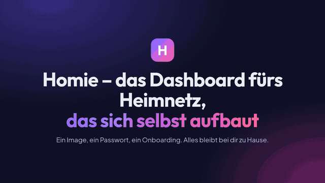](docs/homie-rundgang.mp4)

▶ **[Video: Rundgang in zwei Minuten](docs/homie-rundgang.mp4)** – was Homie macht und wie man es benutzt, aus Sicht eines Nutzers. (Das Bild oben ist die Kurzfassung im Zeitraffer.)

> Alle Bilder und das Video stammen aus der mitgelieferten Demo mit **erfundenen Daten** (`python scripts/demo.py`). Namen, Beträge, Dokumente und Geräte sind ausgedacht.

## Was du damit machst

| | |
|---|---|
| **Mein Tag** – das Wichtigste auf einen Blick: was diesen Monat noch frei ist, Konten, Training der Woche, Schritte, Termine, Aufgaben. Darunter alles, was du eingesprochen hast, nach Themen geordnet. | 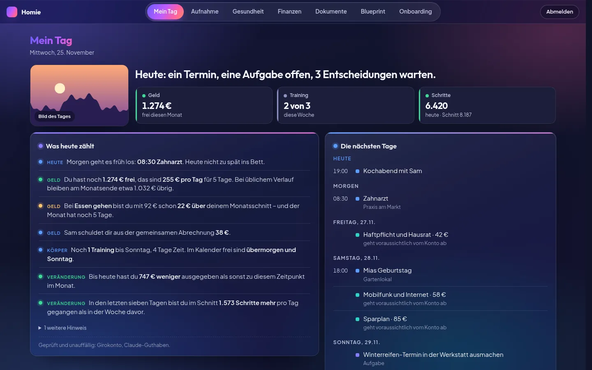 |
| **Trainingskalender** – jede Woche zählt von Montag bis Sonntag gegen dein Ziel; dazu Monate und Jahre im Vergleich. | 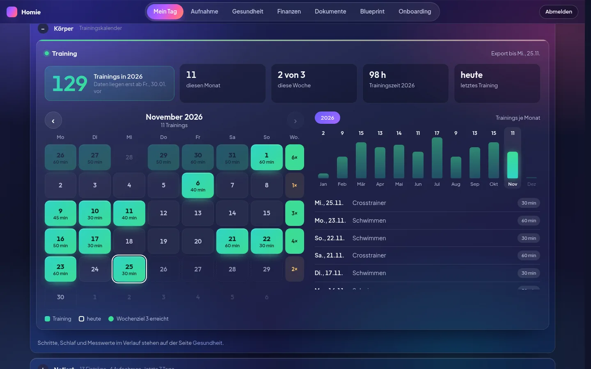 |
| **Aufnahme** – ein großer Knopf für die Sprachnotiz. Daneben: Kassenbon fotografieren oder Kontoauszug hochladen. Was nicht gleich ankommt, bleibt im Gerät und wird nachgesendet. | 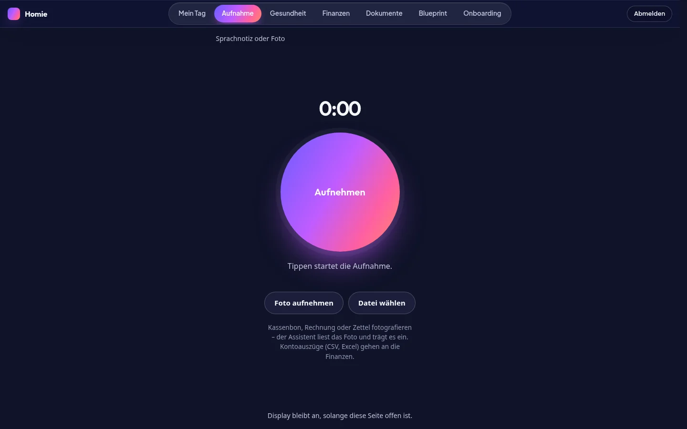 |
| **Dokumente** – dein Paperless-ngx-Archiv als Stream: ein Dokument je Bildschirm, mit Zeitachse, Suche im Volltext, Filtern und Leser für das ganze PDF. | 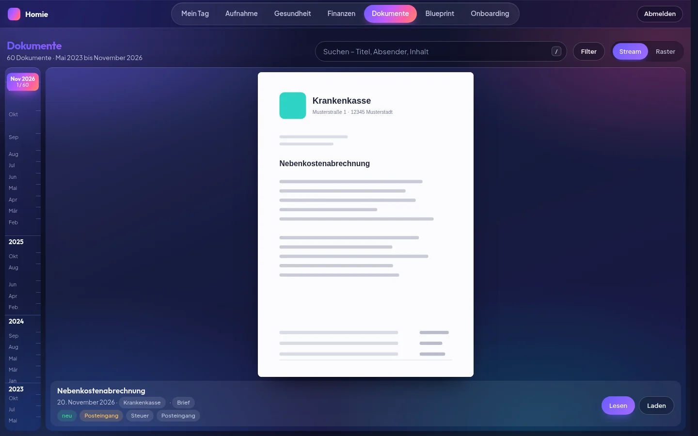 |
| … oder als **Raster** nach Monaten. | 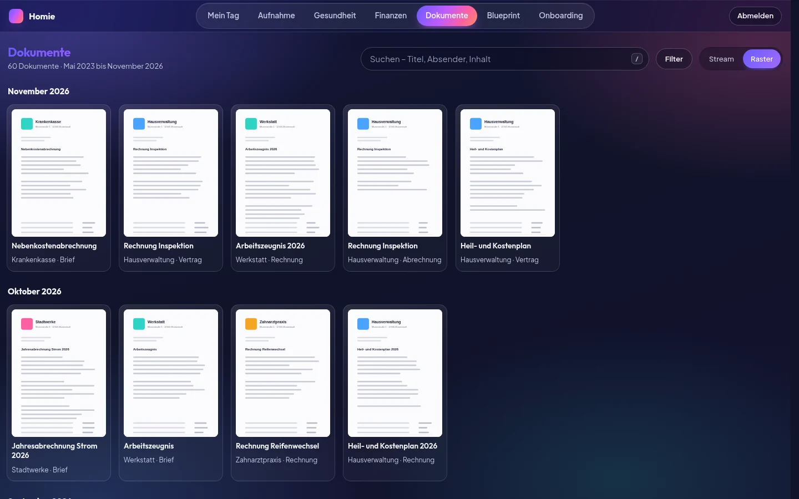 |
| **Finanzen** – Spielraum im Monat, Konten, Einnahmen und Ausgaben, kommende Posten, geteilte Ausgaben. | 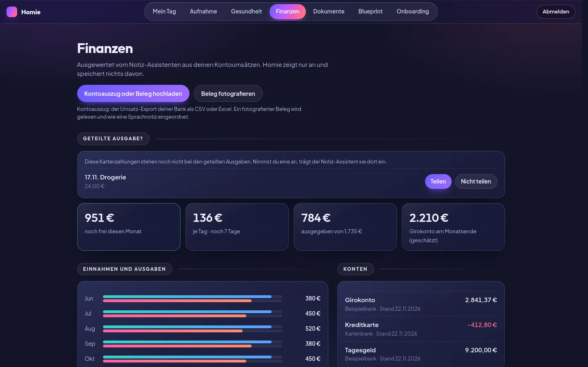 |
| **Gesundheit** – Schritte, Puls, Schlaf und mehr aus der Home-Assistant-App des Handys, mit Wochenverlauf. | 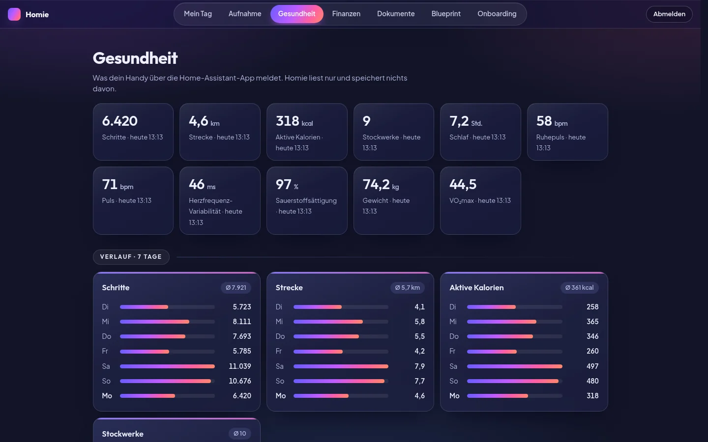 |
| **Blueprint** – dein Heimnetz an einem Ort: ein eigener, handgeschriebener *Plan*, der Zustand aller *Dienste*, das *Netz* mit Geräten, VMs und Containern, und der *Assistent*. | 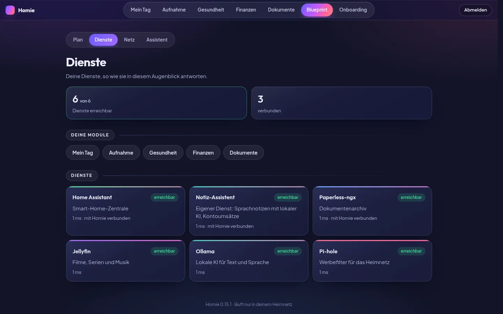 |
| **Onboarding** – hier lernt Homie dein Heimnetz kennen: erkunden, Dienst verbinden, Modul erscheint. | 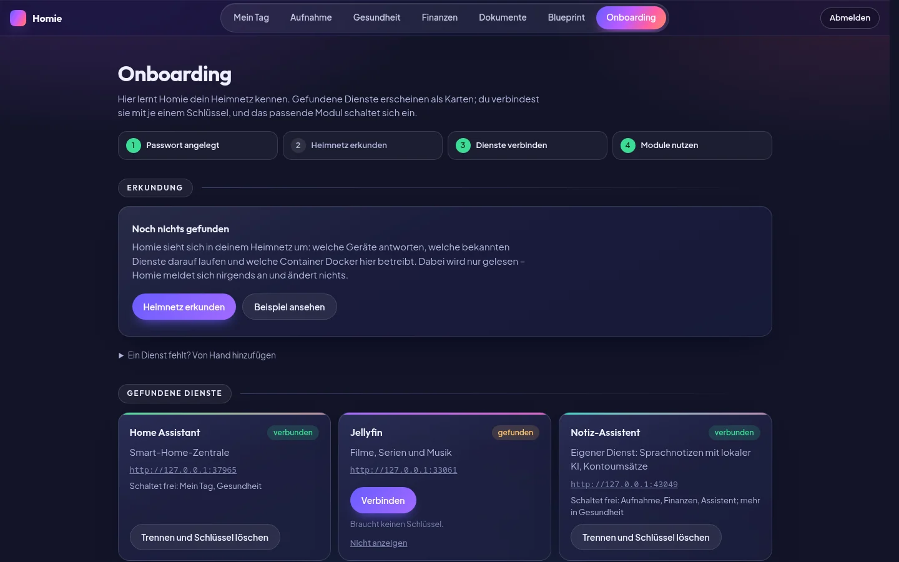 |

Am Handy sieht es so aus:

<p>
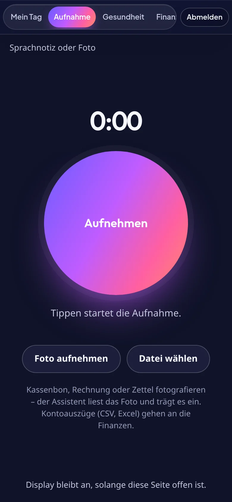
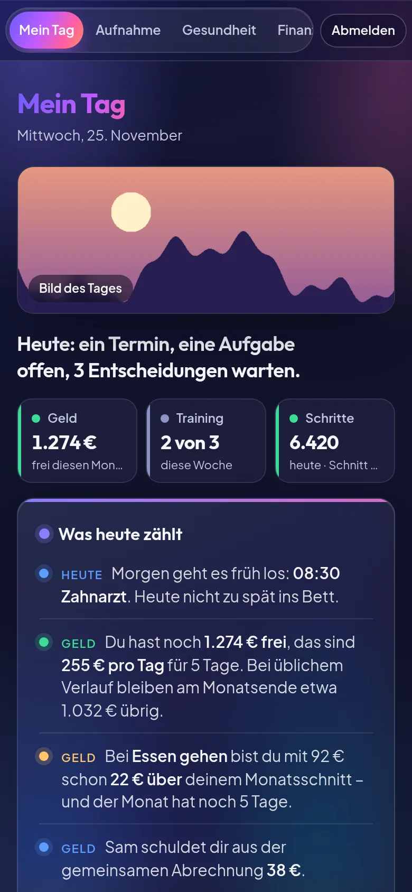
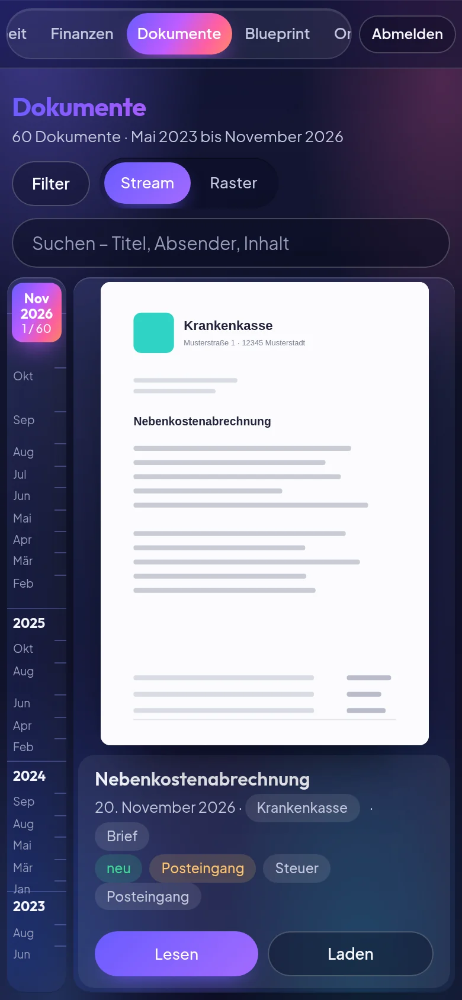
</p>

## So läuft es ab

### Vom Start bis zum fertigen Dashboard

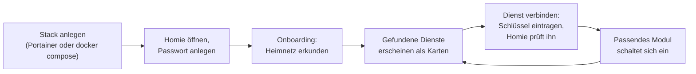

Kein Dienst, kein Modul: Homie zeigt nur, was bei dir wirklich vorhanden und verbunden ist. Schlüssel liegen verschlüsselt im Datenordner der Installation, nie im Programm.

### Vom gesprochenen Satz zum Eintrag

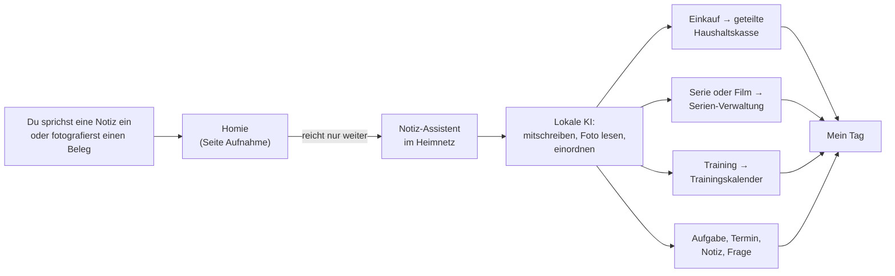

Ein Beispiel: „Beim Bäcker zwei Brötchen für 4,30“ wird ein Eintrag unter *Essen und Trinken* und – wenn du eine geteilte Haushaltskasse führst – eine Ausgabe dort. „Gestern zwei Folgen von … geschaut“ landet mit dem richtigen Tag in der Serien-Verwaltung. Ein fotografierter Kassenbon wird gelesen und genauso eingeordnet.

### Wer mit wem spricht

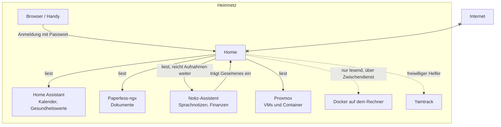

Homie ist für das Heimnetz gedacht. **Bitte nicht ins Internet freigeben.**

## Was du brauchst – und was nicht dabei ist

- Einen Linux-Rechner mit Docker (Mini-PC, VM, NAS). Mehr braucht Homie selbst nicht.
- Module erscheinen nur für Dienste, die du schon betreibst: **Home Assistant** (Mein Tag, Gesundheit), **Paperless-ngx** (Dokumente), **Proxmox** (Netzplan mit VMs).
- *Aufnahme*, *Finanzen* und die eingesprochenen Einträge in *Mein Tag* setzen einen eigenen Dienst voraus, den **Notiz-Assistenten**: Er verschriftlicht Sprachnotizen mit lokaler KI, liest Fotos, wertet Kontoauszüge aus und trägt in andere Dienste ein. **Dieser Dienst gehört nicht zu diesem Repository.** Homie spricht mit ihm über eine kleine Schnittstelle (`/api/eintraege`, `/api/finanzen`, `/api/aufnahme` …); wer sie nachbaut, kann die Module nutzen. Wie die Antworten aussehen, zeigt [scripts/demo.py](scripts/demo.py).
- Alle Module lesen nur und speichern keine Inhalte. Ausnahmen, jeweils nur auf deinen Klick: Eine Aufnahme, ein Foto oder ein Kontoauszug wird an den Notiz-Assistenten abgegeben, und wenn du einen seiner Vorschläge annimmst oder ablehnst, gibt Homie diese Entscheidung weiter. Der Aufnahmeknopf braucht eine https-Adresse, weil Browser das Mikrofon sonst nicht freigeben.

## Erst ansehen, dann installieren

```bash
pip install -r requirements.txt
python scripts/demo.py        # → http://127.0.0.1:8095, Passwort steht in der Ausgabe
```

Die Demo startet Homie mit erfundenen Daten und nachgestellten Diensten, nur auf deinem Rechner.

## Installation in drei Schritten

Du brauchst einen Linux-Rechner mit Docker (ein Mini-PC, eine VM, ein NAS). Homie kommt als fertiges, öffentliches Image – gebaut werden muss nichts, und ein Token braucht es dafür nicht.

### Weg A: mit Portainer

1. **Stack anlegen:** Portainer → *Stacks* → *Add stack* → *Web editor*, Name `homie`. Den Inhalt von [docker-compose.yml](docker-compose.yml) hineinkopieren.
2. **Starten:** *Deploy the stack*. Portainer lädt das Image und startet Homie.
3. **Öffnen:** `http://<Adresse-des-Rechners>:8090` im Browser aufrufen und dein Passwort anlegen. Alles Weitere geschieht im Tab *Onboarding*.

### Weg B: ohne Portainer

1. **Holen:** `docker-compose.yml` in einen leeren Ordner auf dem Rechner legen.
2. **Starten:** in diesem Ordner `docker compose up -d`
3. **Öffnen:** `http://<Adresse-des-Rechners>:8090` aufrufen und dein Passwort anlegen.

Lege das Passwort gleich nach dem Start an: Bis dahin könnte es jeder in deinem Heimnetz tun.

## Was öffentlich ist und was nicht

| | Sichtbarkeit | Inhalt |
|---|---|---|
| Image `ghcr.io/joshlukas/homie` | öffentlich | nur das Programm – keine Daten, keine Schlüssel, keine Adressen |
| Dieses Repository | öffentlich | Quelltext und seine Geschichte – nur Programm, Beispielkonfiguration und erfundene Demo-Daten |
| Datenordner der Installation | nur auf deinem Rechner | alles Persönliche |

**Woher kommt das Image?** GitHub baut es bei jeder Änderung automatisch aus diesem Quelltext ([.github/workflows/image.yml](.github/workflows/image.yml)). Vorher laufen die Tests und die Privat-Prüfung: Steht im Repository eine Heimnetz-Adresse, ein Schlüssel oder eine E-Mail-Adresse, wird nichts gebaut und nichts veröffentlicht.

**Stack direkt aus dem Repository (optional):** In Portainer geht statt *Web editor* auch *Repository* (`https://github.com/joshlukas/homie`). Mit `git clone` lässt sich Homie auch ohne das Image vor Ort bauen.

## Was wo liegt

| Ort | Inhalt |
|---|---|
| Dieses Repository | Nur Programm und Beispielkonfiguration. Nichts Persönliches. |
| Volume `homie-daten` (im Container `/data`) | Alles Private: dein Konto (Passwort nur als scrypt-Prüfwert), Sitzungen, gefundene Dienste, eingetragene Schlüssel (AES-256-GCM-verschlüsselt) und der Hauptschlüssel dazu. |

Eine Sicherung von Homie ist eine Sicherung dieses Volumes. Wer das Volume samt Hauptschlüssel-Datei kopiert, kann die Schlüssel lesen – wer das trennen will, setzt `HOMIE_MASTER_KEY` (siehe `.env.example`).

## Der Stack

- **homie** – das Dashboard. Läuft im Netz des Rechners (`network_mode: host`), damit die spätere Erkundung Geräte im Heimnetz sehen kann. Ohne Root-Rechte, Dateisystem nur lesbar, schreibt ausschließlich in den Datenordner.
- **docker-lesen** – ein Zwischendienst, der Homie einen *nur lesenden* Blick auf Docker gibt (welche Container laufen). Homie bekommt den Docker-Zugang nie direkt, und der Zwischendienst ist nur auf dem Rechner selbst erreichbar. Abschalten mit `HOMIE_DOCKER_LESEN=0`.
- **yamtrack-helfer** – freiwillig und von Haus aus abgeschaltet (`HOMIE_YAMTRACK_SCHREIBEN=1` schaltet ihn ein). Trägt Gesehenes aus Sprachnotizen in ein Yamtrack ein, das auf demselben Rechner läuft. Dafür hat dieser eine Helfer den Docker-Zugang – wer den hat, könnte grundsätzlich alles auf dem Rechner. Deshalb ist er von Homie getrennt, nur auf dem Rechner selbst erreichbar, kennt genau zwei Aufträge (Titel suchen, Gesehenes eintragen) und führt nur sein festes Programm im Yamtrack-Container aus. Aufträge nimmt Homie nur vom verbundenen Notiz-Assistenten an (`POST /api/yamtrack`, mit dessen Schlüssel).

Einstellungen sind freiwillig; alle stehen mit Erklärung in [.env.example](.env.example). Auf Docker Desktop (Windows/Mac) funktioniert das Heimnetz des Rechners anders – vorgesehen ist ein Linux-Rechner.

## Die Erkundung

Ein Klick auf *Heimnetz erkunden* im Onboarding – nie von selbst. Homie liest dabei nur:

1. **Eigenes Netz bestimmen:** nur private Adressbereiche, höchstens 254 Adressen um die eigene.
2. **Ports prüfen:** bei jeder Adresse ein Verbindungsversuch auf rund zwei Dutzend bekannten Ports. Drucker- und SSH-Ports sind ausgenommen.
3. **Dienste erkennen:** offene Web-Ports werden einmal abgerufen; im Katalog ([homie/katalog.py](homie/katalog.py)) steht, woran ein Dienst zu erkennen ist. Weiterleitungen aus dem Heimnetz hinaus werden nicht verfolgt.
4. **Docker lesen:** welche Container auf diesem Rechner laufen, über den nur lesenden Zwischendienst.

Homie meldet sich dabei nirgends an und ändert nichts. Das Ergebnis liegt ausschließlich im Datenordner.

**Von Hand hinzufügen:** Dienste, die nur über einen Namen erreichbar sind (etwa hinter einem Proxy), findet die Suche nach Adressen nicht. Dafür gibt es im Onboarding ein Feld für die Adresse; Homie sieht dort nach, ob ein bekannter Dienst antwortet. Zusätzlich sieht die Erkundung sich alle Ports an, die Docker auf diesem Rechner veröffentlicht.

**Verbinden:** Auf der Karte eines Dienstes trägst du seinen Schlüssel ein. Homie prüft ihn mit einem einzigen lesenden Aufruf bei genau diesem Dienst und legt ihn erst dann verschlüsselt ab. *Trennen* löscht ihn wieder.

## Pläne und helfende Agenten

Ist Proxmox verbunden, zeigt der Netzplan auch die virtuellen Maschinen, und Homie kann **Pläne** für neue VMs aufschreiben: was angelegt würde, was dafür geladen wird und woher, und ob dein Rechner genug Arbeitsspeicher und Platz hat. Ein Plan ist ein Entwurf – angelegt wird nichts.

**Ausführen** kann Homie einen Plan nur, wenn drei Dinge zusammenkommen: der Plan ist machbar, das Proxmox-Token hat die nötigen Schreibrechte (mit einem nur lesenden Token gibt es den Knopf gar nicht; die Planseite nennt die fehlenden Rechte und die Befehle dafür), und du setzt im Dashboard den Haken und bestätigst. Dann legt Homie genau eine neue VM an, gibt ihr eine Einrichtungsanweisung mit (Benutzer ohne Passwort, nur Schlüssel; Docker) und schreibt jeden Schritt ins Protokoll. Bestehende VMs fasst Homie nicht an, und es löscht nie etwas – das steht so im Programm ([homie/ausfuehren.py](homie/ausfuehren.py)) und wird von den Tests überwacht. Empfohlen ist ein eigener Proxmox-Bereich („Pool“) `homie`: Dann *kann* das Token an bestehenden VMs auch gar nichts ändern.

Wer sich von einem KI-Agenten helfen lässt, erzeugt ihm im Onboarding einen eigenen Schlüssel. Damit kann der Agent den Stand lesen und Pläne vorschlagen; bestätigen, verbinden oder Schlüssel sehen kann er nicht. Einzelheiten in [AGENTS.md](AGENTS.md).

## Gesundheitsdaten vom Handy

Schickt eine Gesundheits-App auf dem Handy ihre Daten an `…/api/health-webhook`, reicht Homie sie unverändert an den Notiz-Assistenten weiter. Das ist der einzige Weg, der ohne Anmeldung etwas annimmt: Die App unterschreibt ihre Lieferung, der Notiz-Assistent prüft die Unterschrift; Homie kennt das Geheimnis der App nicht und speichert nichts. Ohne Unterschrift, bei mehr als 12 MB oder mehr als 30 Lieferungen je Minute lehnt Homie selbst ab.

## Fotos und Kontoauszüge

Auf der Seite *Aufnahme* lässt sich neben der Sprachnotiz ein Foto aufnehmen oder eine Datei wählen; dieselben Knöpfe stehen auf der Seite *Finanzen*. Ein Foto (Kassenbon, Rechnung, Zettel) geht an den Notiz-Assistenten, der es liest und wie eine Sprachnotiz einordnet. Ein Kontoauszug (Umsatz-Export der Bank als CSV oder Excel) geht in die Finanzauswertung. Homie reicht beides nur durch und behält nichts.

## Eigene Seiten

Liegt im Ordner `seiten` des Datenordners eine Datei `blueprint.html`, erscheint sie als Bereich *Plan* unter *Blueprint*: als Standbild ohne Skripte, mit Homies Menüband darüber. Weitere HTML-Dateien dort erscheinen als zusätzliche Tabs. Solche Seiten laufen abgeschottet: Skripte dürfen laufen, kommen aber nicht an Homies Anmeldung oder Schnittstellen und laden nichts aus dem Internet nach (außer Bildern).

## Module

Jedes Modul erklärt in [homie/module.py](homie/module.py), welchen Dienst und welchen Schlüssel es braucht. Es erscheint erst im Menü, wenn ein passender Dienst verbunden ist und sein Schlüssel in der Ablage liegt. Bis dahin steht im Onboarding, was noch fehlt.

## Alltag

- **Aktualisieren:** Portainer → Stack → *Pull and redeploy* (mit *Re-pull image*). Ohne Portainer: `docker compose pull && docker compose up -d`.
- **Dienst ohne Browser verbinden:** `docker exec -i homie python -m homie verbinden "Home Assistant" token < datei-mit-dem-token` – der Schlüssel kommt über die Eingabe, wird beim Dienst geprüft und verschlüsselt abgelegt; angezeigt wird er nie. Mit `--adresse URL` wird der Dienst vorher hinzugefügt.
- **Passwort vergessen:** `docker exec homie python -m homie passwort-zuruecksetzen` – danach legst du im Browser ein neues an. Daten und Schlüssel bleiben.
- **Entfernen:** Stack löschen. Das Volume `homie-daten` bleibt, bis du es ausdrücklich löschst.

## Entwicklung

```bash
pip install -r requirements.txt
python -m unittest discover -s tests -v                 # Tests
HOMIE_DATA=./data HOMIE_DOCKER_LESEN=0 python -m homie  # lokal starten, http://localhost:8090
scripts/privat-pruefung.sh                              # vor jedem Push: nichts Privates im Repository?
```

Wer sich von einem KI-Agenten helfen lässt: [AGENTS.md](AGENTS.md).

## Lizenz

Homie steht unter der [MIT-Lizenz](LICENSE). Die mitgelieferten Schriften Outfit und Plus Jakarta Sans stehen unter der SIL Open Font License, siehe [homie/static/schrift/LIZENZ.txt](homie/static/schrift/LIZENZ.txt).
